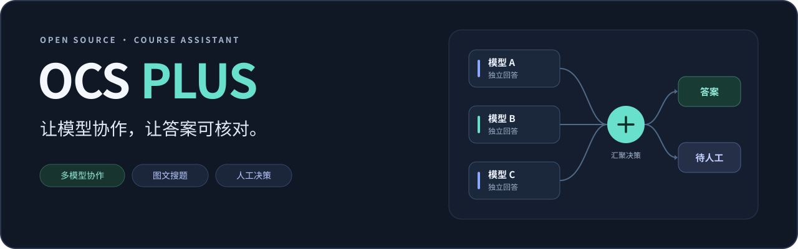
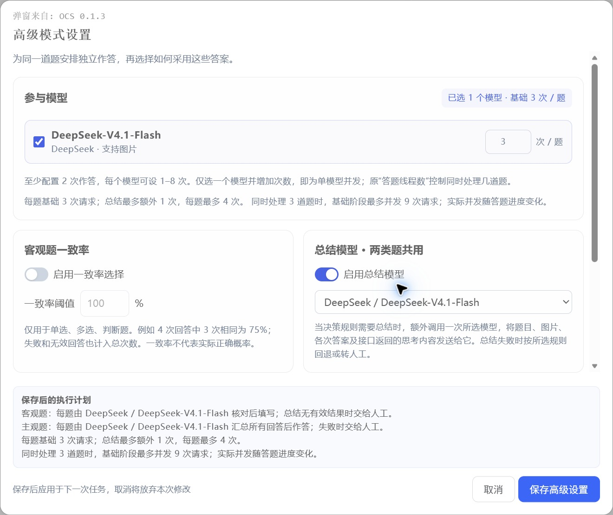
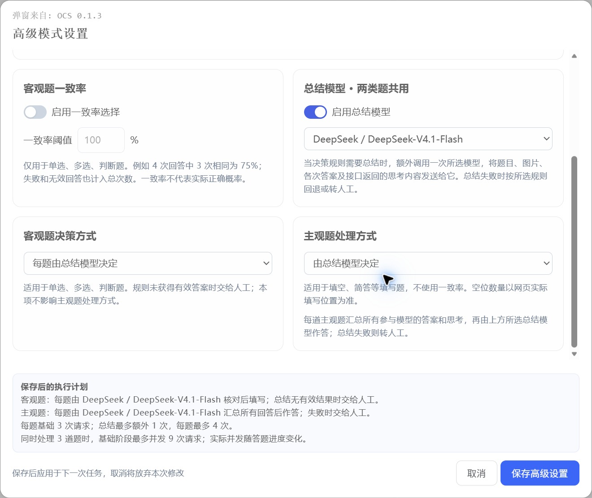
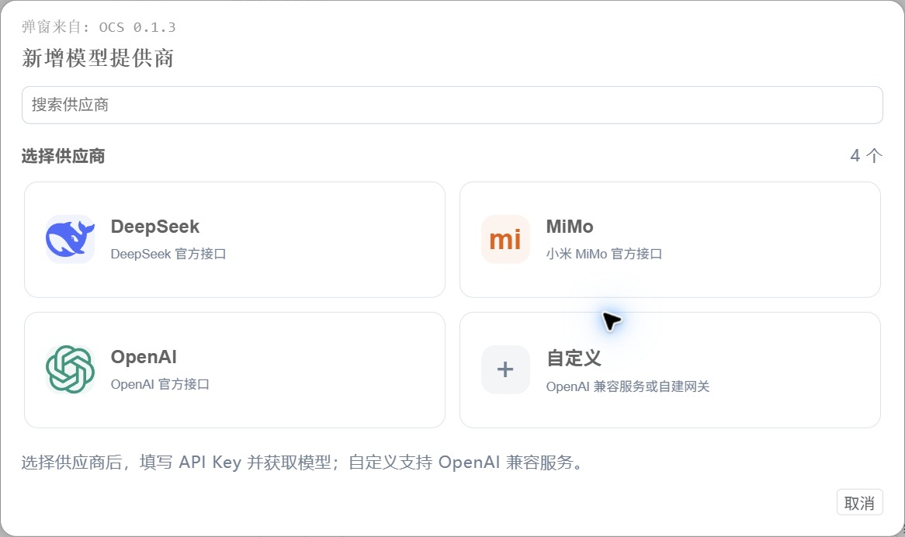
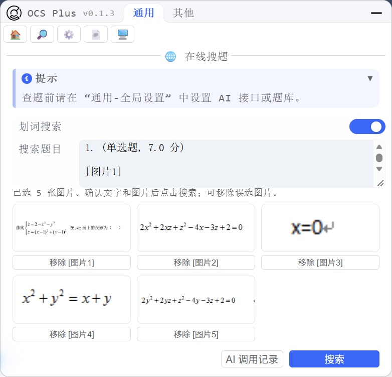

<div align="center">
  
  <br><br>
  <p><strong>基于 OCS 的可扩展网课助手</strong></p>
  <p>接入自己的模型，让图文搜题、联合答题与人工核对连接在一起。</p>
  <p>
    <a href="https://github.com/broken-star1999/ocsjs-plus/releases/latest/download/ocs.user.js"></a>
    <a href="docs/usage.md"></a>
    <a href="https://github.com/broken-star1999/ocsjs-plus/releases"></a>
    <a href="https://github.com/broken-star1999/ocsjs-plus/issues"></a>
  </p>
  <p>
    <a href="LICENSE"></a>
    <a href="docs/usage.md"></a>
    <a href="https://github.com/broken-star1999/ocsjs-plus/actions/workflows/verify-plus.yml"></a>
  </p>
</div>

<p align="center">
  <a href="#快速开始">快速开始</a> · <a href="#界面预览">界面预览</a> · <a href="docs/usage.md">配置说明</a> · <a href="CHANGELOG.md">更新记录</a> · <a href="https://docs.ocsjs.com">原版文档</a>
</p>

## 从接入模型，到核对答案

OCS Plus 保留 [OCS](https://github.com/ocsjs/ocsjs) 的课程平台适配和原有题库流程，在此基础上增加 AI 模型接入与答案处理。普通模式轻量使用，高级模式按需组合。

<table>
  <tr>
    <td width="50%" valign="top">
      <h3>01 · 模型自由组合</h3>
      <p>DeepSeek、MiMo、OpenAI 与自定义兼容服务。独立管理提供商、模型列表和请求参数。</p>
    </td>
    <td width="50%" valign="top">
      <h3>02 · 同题多次核对</h3>
      <p>多模型联合答题，也支持单模型多次作答。分别设置参与模型与同题请求次数。</p>
    </td>
  </tr>
  <tr>
    <td width="50%" valign="top">
      <h3>03 · 分歧交给人工</h3>
      <p>客观题与主观题独立决策，查看候选答案和调用详情。已接入页面可采用答案或重做单题。</p>
    </td>
    <td width="50%" valign="top">
      <h3>04 · 文字图片一起搜</h3>
      <p>划选网页文字与图片，先预览、再发送。图片输入由实际支持识图的模型完成。</p>
    </td>
  </tr>
</table>

## 界面预览

### 配置模型，也配置答案如何被采用



<p align="center"><sub>学习通页面中的 OCS Plus 真实运行界面。</sub></p>

<details>
<summary><strong>展开查看：主客观题决策、提供商选择与图文搜题</strong></summary>

### 主客观题独立决策



### 提供商入口



### 学习通中的图文选区



四张截图均直接截取自学习通中的实际脚本界面，裁去功能面板以外的个人信息，不展示密钥。

</details>

## 快速开始

1. **安装脚本管理器**：Tampermonkey（油猴）或脚本猫。
2. **安装 OCS Plus**：[点击安装最新正式版](https://github.com/broken-star1999/ocsjs-plus/releases/latest/download/ocs.user.js)。安装文件为 `ocs.user.js`。
3. **配置提供商**：进入 **通用 → 全局设置 → 管理提供商与模型**，填写接口、获取并添加模型。
4. **选择作答方式**：开启 **使用 AI 替代题库**，选择普通模式模型，或打开 **高级模式设置**。

完整配置、图片输入条件、主客观题规则和重做范围见 [使用指南](docs/usage.md)。

> 课程页面适配与 AI 接入分别维护；图片输入需要模型实际支持。候选回填和单题重做由对应页面适配器提供，一致率表示回答的一致程度。题目及启用的图片会发送到配置的服务。

<details>
<summary><strong>开发者入口：构建、测试与项目结构</strong></summary>

## 本地开发

依赖版本与构建环境以 [package.json](package.json) 和 [CI 配置](.github/workflows/verify-plus.yml) 为准。

```sh
pnpm install --frozen-lockfile
npm run build
npm test
```

构建不需要 AI 密钥，安装产物位于 `dist/ocs.user.js` 与 `dist/ocs.meta.js`。

`npm run preview:ai` 启动界面预览，`npm run preview:ai-chain` 启动链路夹具。预览使用模拟响应，不调用真实 AI 服务。

| 路径 | 职责 |
| --- | --- |
| [`packages/core`](packages/core) | AI 请求、答案解析、联合决策、题型匹配与任务控制 |
| [`packages/scripts`](packages/scripts) | 课程平台适配、配置界面、结果展示与更新入口 |
| [`packages/utils`](packages/utils) | Userscript 元信息与构建工具 |
| [`scripts`](scripts) / [`tests`](tests) | 构建发布脚本、自动化回归与本地预览 |

</details>

<details>
<summary><strong>维护与发布：Plus 功能和上游同步</strong></summary>

Plus 功能在默认分支维护，上游镜像保留原版代码。功能开发与上游同步通过独立分支和 PR 合入，正式安装与更新使用 [本仓库 Releases](https://github.com/broken-star1999/ocsjs-plus/releases)。

维护流程见 [Fork 维护说明](docs/maintaining-fork.md)，逐版改动与验证记录见 [CHANGELOG](CHANGELOG.md)。

</details>

## 致谢与许可

由 [broken-star1999](https://github.com/broken-star1999) 维护，基于 [enncy](https://github.com/enncy) 与 [OCS 贡献者](https://github.com/ocsjs/ocsjs/graphs/contributors) 的工作扩展，保留原作者署名与 [MIT License](LICENSE)。提供商图标使用 [LobeHub Icons](https://github.com/lobehub/lobe-icons) 的相关资源，许可声明保留在源文件中。

<p align="center"><sub>OCS Plus · Open source, built on OCS.</sub></p>
